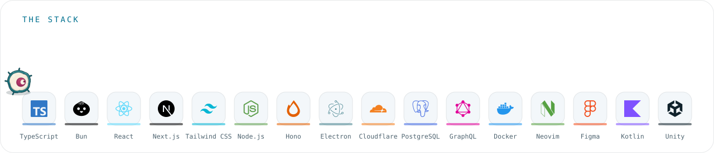

<picture><source media="(prefers-color-scheme: dark)" srcset="assets/hero-dark.svg"></picture>

Tech lead at Axis Communications in Sweden by day, [Empryo](https://empryo.com) by night. One engine behind the desktop app, the terminal, headless CI and your iPhone. It maps your repo, edits code by symbol and runs your checks, with any model or the plan you already pay for.

<picture><source media="(prefers-color-scheme: dark)" srcset="assets/genome-dark.svg"></picture>

- **Symbols, not strings.** Edits go through the AST and LSP, so a rename is a rename.
- **Cheap to run.** In an [independent benchmark by important.is](https://empryo.com/benchmarks/important-is), the same model used 51% fewer input tokens in Empryo than in Claude Code.
- **Free.** Bring your own key, a local model, or the plan you already pay for.

<picture><source media="(prefers-color-scheme: dark)" srcset="assets/garden-dark.svg"></picture>

<picture><source media="(prefers-color-scheme: dark)" srcset="assets/stack-dark.svg"></picture>

 

Mote says hi. If Empryo saves you tokens, [sponsoring](https://github.com/sponsors/proxysoul) buys more of them.

